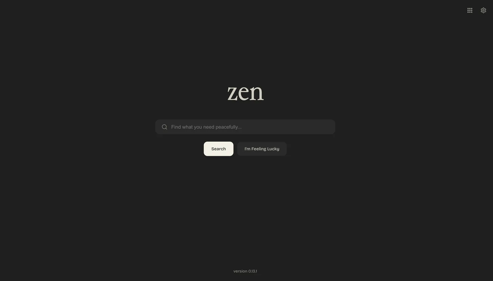
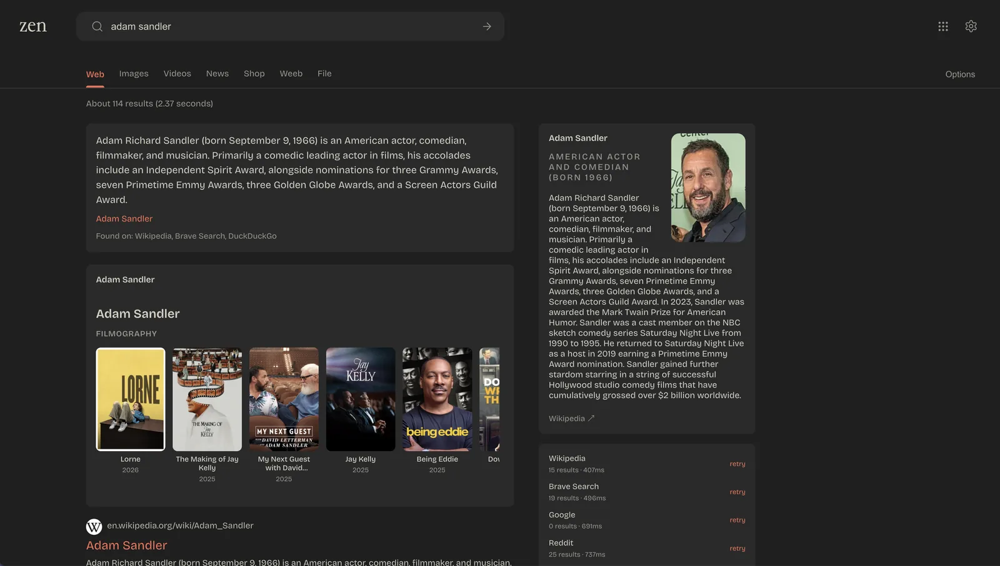
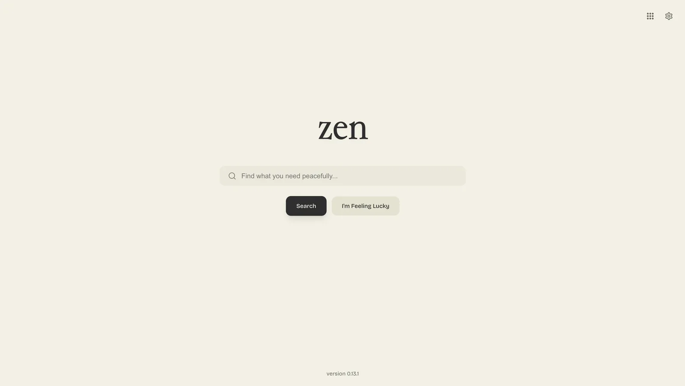
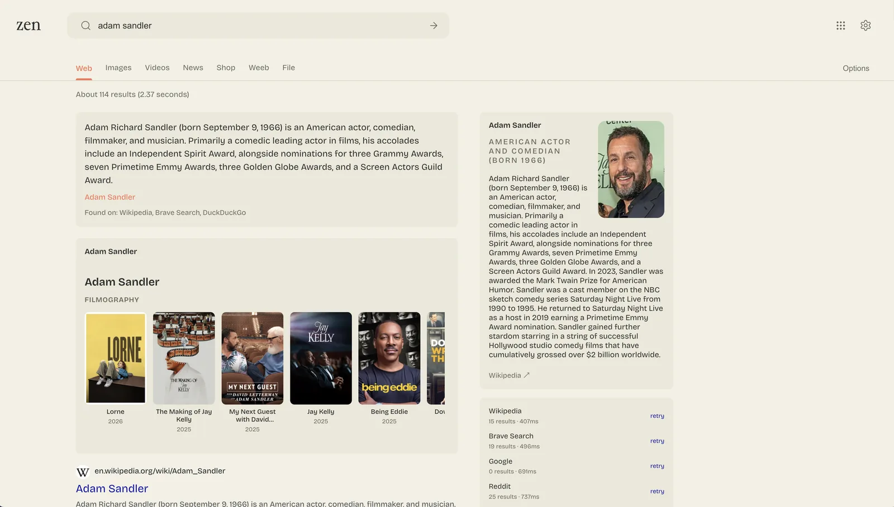

# Zen Theme

    
    
    
    

This is an example theme on how to override the default theme in degoog.

index.htm and search.html can both be overridden, however new updates may break the theme, so if you are a maintainer make sure to keep the theme as up to date as the latest release of degoog.
